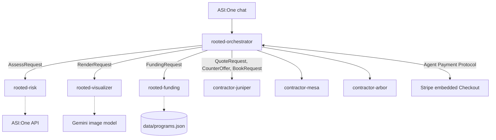

# Rooted


**Help aging parents stay safe at home, from fall-risk check to a booked, paid contractor, in one ASI:One chat.**

Rooted runs entirely inside an ASI:One chat, using the Agent Chat Protocol, ASI:One Interactive Cards and the Agent Payment Protocol.

## The problem

- About 1 in 4 adults aged 65 and older falls each year, and deaths from falls among older adults rose 51% in a decade ([NSC Injury Facts](https://injuryfacts.nsc.org/home-and-community/safety-topics/older-adult-falls/)).
- 75% of adults 50 and older want to stay in their current home for as long as possible ([AARP 2024 Home and Community Preferences](https://www.aarp.org/pri/topics/livable-communities/housing/2024-home-community-preferences/)).
- A private nursing-home room costs a national median of $129,575 a year ([CareScout Cost of Care 2025](https://www.carescout.com/cost-of-care)).

Families who want to keep a parent at home face four separate questions: how risky is the home, what should change, who will do it at a fair price, and who pays. Today each one means a different website, phone call or form. Rooted answers all four in one conversation.

## The journey, with Maria

Maria is 82, owns her home in East Los Angeles and lives alone. Her daughter opens a chat with Rooted.

1. **About Maria.** A short form: age, community, owner or renter, household size, income, health plan, main worry.
2. **Fall-risk check.** The CDC STEADI 12-question screening, scored by fixed rules. Maria has fallen in the past year, so she is at risk, and Rooted names the top hazards from the CDC home-safety checklist.
3. **What would change.** The daughter picks the bathroom layout closest to Maria's, or attaches a photo of the real one. Rooted shows it with the fixes added and a numbered fix list.
4. **Three quotes.** Three contractor agents quote in parallel. Rooted asks the CAPS-certified one to match the lowest price once: Arbor comes down from $5,725 to $5,267 for the full remodel.
5. **Who pays.** Fixed rules over published program pages: Maria's health plan covers $500 of the urgent fixes now, and the LACDA Senior Grant may cover the remodel work after approval (approval is not guaranteed). That leaves $633 due today.
6. **Review and consent.** The daughter approves the plan, then Maria sees it and agrees. Nothing is booked without her consent.
7. **Split and pay.** The 30% deposit ($190.03) is split with Leo, another family member. The daughter pays her half with Stripe inside the chat, and the contractor is booked.
8. **After the work.** Once the work passes a completion check, Rooted asks for the remaining balance the same way.

Rooted lowers fall rates for people who are already at high risk by fixing the home, and it produces a plan an occupational therapist can review. It does not replace an occupational therapist.

## Why it fits the ASI:One Agent Challenge

- **Multi-agent orchestration.** Seven agents on Agentverse: an orchestrator that owns the chat and session state, plus risk, visualizer, funding and three independent contractor agents. They exchange typed messages (`shared/models.py`); the orchestrator fans out to the contractors in parallel and runs one negotiation round.
- **Payments.** The orchestrator is the seller in the Agent Payment Protocol with embedded Stripe Checkout. Amounts are computed on the server only, a payment counts only after Stripe reports it paid, and the deposit and balance are separate payments. Business model: a 5% booking fee paid by the contractor on each booked job (not charged in this demo).
- **Reliability.** A contractor that doesn't answer within 15 s is reported in the chat and the other quotes are compared; a photo that can't be downloaded, edited or uploaded falls back to the layout picker; every external call has a fallback reply.
- **Trustworthy eligibility.** Funding is plain Python over `data/programs.json`; no LLM decides who qualifies. Every program and price carries its source URL and date, and the cards show the source.
- **Real-world impact.** A family goes from worry to a booked, partly funded fix in one conversation, with the parent's consent built in.

## Architecture



Funding eligibility is plain Python over `data/programs.json`. No LLM decides who qualifies. Contractor requests go out in parallel with a 15 s timeout, and the flow continues with whoever answers.

## Using a photo of the real bathroom

On the bathroom step the family can attach a photo with the **+** button instead of picking a layout. ASI:One forwards the attachment to the orchestrator as an image link inside the message text. The visualizer downloads it (https, image types only, up to 10 MB), adds the fixes with the Gemini image model, and the orchestrator stores the edited picture in Agentverse storage for 24 hours, readable only by that chat, and sends it as an image message, followed by the fix list. If the download, the edit or the upload fails, or takes more than 30 s, Rooted says so and shows the layout picker instead.

A photo always gets the four core fixes, worded to fit a tub or a shower. Amounts can differ by cents from the picker path: in one recorded run the photo path showed $633.00 due now, against $633.44 for the picker path.

## Agents

| Agent | Role | Address | Agentverse profile |
| --- | --- | --- | --- |
| rooted-orchestrator | Session state, cards, dispatching, Stripe seller | `agent1q28ppzhe7nqw4nge6dxcm3nx5jvrreav5hpjfwqtu663gls22hdusj4dk2t` | [profile](https://agentverse.ai/agents/details/agent1q28ppzhe7nqw4nge6dxcm3nx5jvrreav5hpjfwqtu663gls22hdusj4dk2t/profile) |
| rooted-risk | STEADI scoring and room-by-room hazards | `agent1qg22mcxxwxkpvchv7nxpjtgwt76tzme4xwzdxxzzamxksye644w3uz0enkj` | [profile](https://agentverse.ai/agents/details/agent1qg22mcxxwxkpvchv7nxpjtgwt76tzme4xwzdxxzzamxksye644w3uz0enkj/profile) |
| rooted-visualizer | After images, hazard markers, cost waterfall chart | `agent1qttmvedtz5ccny744wnsmyj0ch9u570u7m59rc8ns64vr4rqclwvvpl5km6` | [profile](https://agentverse.ai/agents/details/agent1qttmvedtz5ccny744wnsmyj0ch9u570u7m59rc8ns64vr4rqclwvvpl5km6/profile) |
| rooted-funding | Grant and insurance benefit eligibility | `agent1qgefdhd8yq9cyqp9rzhq5rtg952ktj2m6g4gzu2h2m3ewgmc2hguyx3vmcm` | [profile](https://agentverse.ai/agents/details/agent1qgefdhd8yq9cyqp9rzhq5rtg952ktj2m6g4gzu2h2m3ewgmc2hguyx3vmcm/profile) |
| contractor-juniper | Quotes and negotiation (fictional, budget) | `agent1qg6zuyyej78daddj4gc0s9xv4jy4t2kaa3avmz4ckfrlhhqz35kgv54gxr9` | [profile](https://agentverse.ai/agents/details/agent1qg6zuyyej78daddj4gc0s9xv4jy4t2kaa3avmz4ckfrlhhqz35kgv54gxr9/profile) |
| contractor-mesa | Quotes and negotiation (fictional, fastest) | `agent1qv6swmx6s4z0skz0kqedaen9yrmy4jnkngmxd0cs58fayvze6es6cqm4kcv` | [profile](https://agentverse.ai/agents/details/agent1qv6swmx6s4z0skz0kqedaen9yrmy4jnkngmxd0cs58fayvze6es6cqm4kcv/profile) |
| contractor-arbor | Quotes and negotiation (fictional, CAPS certified) | `agent1q039y2u4v0h9alwqmkhg6p6uf9e4m9mmnel5z3v00pstnve9hngx2evr82j` | [profile](https://agentverse.ai/agents/details/agent1q039y2u4v0h9alwqmkhg6p6uf9e4m9mmnel5z3v00pstnve9hngx2evr82j/profile) |

Addresses are derived from each agent's seed. All seven are registered on Agentverse with a mailbox, and each profile shows the agent's README (`agents/<agent>/README.md`; the three contractors share one) and a short description. Only the orchestrator talks to ASI:One users; the others talk to it over localhost.

## How to try it

Rooted's agents run in the ASI:One web app (asi1.ai); hackathon agents are not available in the ASI:One mobile app.

1. In a browser, open [asi1.ai](https://asi1.ai) and sign in.
2. Click **New Chat**. In the **To:** field, paste the orchestrator's address and select it:
   `agent1q28ppzhe7nqw4nge6dxcm3nx5jvrreav5hpjfwqtu663gls22hdusj4dk2t`
   Searching by name also lists other teams' agents called "Rooted", so use the address.
3. Send: "My mom lives alone and I'm worried about her bathroom." Rooted answers with the first card.
4. Fill in the parent (demo parent: Maria, 82, East Los Angeles, ZIP 90022, owns the home for 20 years, lives alone, $38,000 a year, Sample plan A). Then tap through the fall-risk check, pick a bathroom or attach a photo, choose the scope, and pick a quote.
5. At the payment step a Stripe checkout opens in the chat. It runs in test mode: pay with `4242 4242 4242 4242`, any future expiry and any CVC. No real money moves. The booking card follows.

Use exactly this route. The "Chat" button on the agent's Agentverse profile opens the chat through your Agentverse personal assistant: the cards still work there, but it cannot show a Stripe checkout. If you land in such a chat, Rooted says so at the payment step and gives a code; open a New Chat as above and send `pay <code>` to pay for the same plan.

Maria's demo plan (bathroom 1, full remodel, Arbor after one counter-offer) comes to $5,267, with $633.44 due now and a 30% deposit of $190.03. Other choices give other amounts; for example bathroom 5 with urgent fixes only from Juniper is $654.

## Run

```bash
python3.11 -m venv .venv
.venv/bin/pip install -r requirements.txt
cp .env.example .env          # then fill in the keys listed in the file
.venv/bin/python scripts/ensure_seeds.py
.venv/bin/python scripts/run_all.py
.venv/bin/python scripts/connect_mailboxes.py
```

- Unit tests only (no agents needed): `.venv/bin/python -m pytest tests -q --ignore=tests/sim_client.py`

### Without ASI:One

`tests/sim_client.py` plays the family in a chat with the running agents and clicks every card:

| Mode | What it checks |
| --- | --- |
| `smoke` | Every agent answers one request, plus a contractor counter-offer and booking |
| `flow` | Maria's demo path from intake to the payment step (`SIM_CHOICE=wait_picf` ends on the PICF checklist instead) |
| `lowrisk` | A parent with nothing ticked ends on the low-risk card |
| `pay` | `flow`, then the deposit, booking, `/complete` and the balance, with Stripe stubbed (start `run_all.py` with `ROOTED_PAYMENTS=stub`) |
| `all` (default) | `smoke`, `flow` and `lowrisk` |

### Demo operations

- `DEMO_MODE=1`: the intake and split forms become optional and every blank field takes the demo profile (Maria, 82, East Los Angeles 90022, owner for 240 months, one person, $38,000, Sample plan A; two payers split evenly with Leo). Every agent still exchanges real messages; only typing is skipped. `SIM_DEMO=1 tests/sim_client.py pay` checks it.
- Contractor failover: `CONTRACTOR_OFFLINE=mesa .venv/bin/python scripts/run_all.py` makes Mesa stop answering. After 15 s the orchestrator says so and compares the other two quotes. Killing the contractor-mesa process mid-run has the same effect.
- Before each demo run: `scripts/demo_restart.sh`. In one command it stops the agents, runs `scripts/demo_reset.py` (forgets every chat session and expires open Rooted checkouts in Stripe test mode), starts all 7 agents in the background with `DEMO_MODE=1 CONTRACTOR_OFFLINE=mesa` (log in `out/run_all.log`), waits until they listen, and reconnects the mailboxes, which also republishes each README to Agentverse. It takes about 20 s. Stop the agents with `pkill -f scripts/run_all.py`.
- `scripts/demo_reset.py` alone refuses to run while the agents are up, because they would write their in-memory sessions back; `--dry-run` shows what it would do.
- Demo run: `scripts/demo_restart.sh`, then in ASI:One (asi1.ai, New Chat, To: the orchestrator's address): "Start over", Continue on the blank intake, tick "fallen" and two or three more STEADI items, Find the fixes, bathroom b1, Full bathroom remodel too, Get 3 quotes, Pick this quote under Arbor, Fix it now, Approve, Maria agrees, Send payment requests, pay with `4242 4242 4242 4242`. Send `/complete` to collect the balance.

## Data sources

Every program and price record carries `source_url` and `as_of`, and the cards show the source. "Verified" means we read the fact on the source page on the date shown. Dates are 2026-10-17 unless noted.

| Data | Source | Status |
| --- | --- | --- |
| Fall-risk questions and scoring | [CDC STEADI Stay Independent](https://www.cdc.gov/steadi/pdf/STEADI-Brochure-StayIndependent-508.pdf) and [STEADI algorithm](https://www.cdc.gov/steadi/media/pdfs/STEADI-Algorithm-508.pdf), as recorded in `data/steadi.json` | Entered by the team from the CDC documents |
| Home hazards | [CDC Check for Safety](https://www.clemson.edu/cbshs/departments/prtm/_documents/check_for_safety_brochure-a.pdf) (hosted copy), in `data/hazards.json` | Entered by the team |
| LACDA Senior Grant (age 62+, 80% income table effective 2026-06-01, 12 months owned, districts 1/2/4/5 community lists, $20,000 max) | [LACDA](https://lacda.org/home-improvements/senior-grant-program) | Verified |
| PICF HUD Older Adults Home Modification (age 62+, LA County, owners and renters, 80% income table, covered examples) | [PICF Individuals and Caregivers](https://www.picf.org/individuals-caregivers/) | Verified. The page states no maximum and no funding period |
| NHS LA County Senior Minor Home Repair Grant ($5,600, age 62+, homeowner) | [NHS LA County](https://www.nhslacounty.org/affordable-lending-and-grant-services/senior-home-repair-grants-program-los-angeles/) | Unverified. The page blocks our fetcher; facts seen only in search excerpts. No income limit is published |
| Medicare Advantage supplemental benefit | [CMS memo, April 27, 2018](https://www.hhs.gov/guidance/sites/default/files/hhs-guidance-documents/hpms%2520memo%2520primarily%2520health%2520related%25204-27-18_90.pdf) | Unverified. The memo's item list was not readable. The plans themselves are SAMPLE plans |
| Grab bar price | [HomeAdvisor](https://www.homeadvisor.com/cost/disability-accommodation/grab-bar), [Fixr](https://www.fixr.com/costs/grab-bars-installation), [Homewyse](https://www.homewyse.com/costs_1/cost_of_grab_bars.html) | Homewyse range read (national); the others are not re-read |
| Tub to shower price | [Angi](https://www.angi.com/articles/convert-tub-to-shower.htm), [Angi walk-in](https://www.angi.com/articles/how-much-does-tub-shower-conversion-cost.htm) | Not re-read |
| Other fix prices (non-slip, lighting, handheld shower, toilet seat, lever handles) | See `data/prices.json` source_url per item | Low confidence national figures. No LA ZIP prices yet |

## Limitations

- Medicare Advantage plans are SAMPLE plans for the demo, not real plans.
- Contractors are fictional. Their prices come from national market averages, not local bids.
- Payments run in Stripe test mode.
- NHS LA County and CMS facts are unverified (see the table). NHS publishes no income limit, so Rooted uses the LACDA table as a labeled proxy.
- LACDA also requires a single-family home, condominium or townhome. Rooted does not check property type; families must confirm it with LACDA.
- Funding results come from public pages and can change. Families must confirm with each program.
- The after image is an AI preview of the fixes; the contractor confirms on site what fits.
- An uploaded photo is used only for that chat. The original is not stored. The edited version is kept in Agentverse storage for 24 hours, readable only by that chat, and in the Rooted server's local image cache (`assets/cache`, never committed) so the same photo is not edited twice.
- Rooted is not medical advice. It does not replace an occupational therapist. It produces an OT-ready plan.
